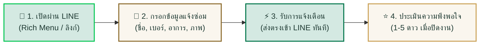

# 📋 คู่มือการใช้งานระบบแจ้งซ่อมไอที (SMKCC IT Helpdesk)
### งานเทคโนโลยีสารสนเทศ วิทยาลัยชุมชนสมุทรสาคร
*ฉบับสรุป 1 หน้า (One-Page Infographic Quick Guide)*

---

> [!TIP]
> **ระบบใช้งานผ่าน LINE ได้ทันที** โดยไม่ต้องจำรหัสผ่าน ไม่ต้องโหลดแอปเพิ่ม และมีระบบแจ้งเตือนความคืบหน้าตรงเข้าแชท LINE อัตโนมัติทุกขั้นตอน

---

## 🧭 แผนผังขั้นตอนการแจ้งซ่อม (Workflow Overview)

---

## 4 ขั้นตอนการใช้งานอย่างละเอียด

### 🔹 ขั้นตอนที่ 1: เปิดหน้าแจ้งซ่อมผ่าน LINE
* **บนสมาร์ตโฟน (iOS / Android):** 
  * เข้าห้องแชท LINE บัญชี **SMKCC IT Service**
  * กดที่เมนู **"แจ้งซ่อมไอที"** บริเวณแถบเมนูด้านล่าง (Rich Menu)
* **บนคอมพิวเตอร์ (LINE PC):**
  * คลิกลิงก์ใน **ข้อความทักทาย** หรือพิมพ์คำว่า **"แจ้งซ่อม"** ส่งในแชท บอทจะส่งลิงก์กลับมาให้คลิกเข้าสู่ระบบ
* ✨ **จุดเด่น:** ระบบดึงชื่อโปรไฟล์และ LINE ID ของท่านโดยอัตโนมัติ ไม่ต้องสมัครสมาชิก

---

### 🔹 ขั้นตอนที่ 2: กรอกข้อมูลแจ้งปัญหา (ใช้เวลาไม่เกิน 1 นาที)
กรอกข้อมูลสั้นๆ เพื่อให้เจ้าหน้าที่เข้าดำเนินการแก้ไขได้ตรงจุด:
1. **ข้อมูลผู้แจ้ง:** พิมพ์ชื่อ-นามสกุลจริง และเบอร์โทรศัพท์ที่ติดต่อได้สะดวก
2. **สถานะ:** เลือกว่าเป็น **นักศึกษา** หรือ **บุคลากร**
3. **สถานที่:** ระบุอาคาร, ชั้น หรือเลขห้อง เช่น *อาคาร 1 ชั้น 2 ห้องคอมพิวเตอร์ 102*
4. **หมวดหมู่ปัญหา:** เลือกประเภทปัญหา เช่น
   * อินเทอร์เน็ต / สัญญาณ Wi-Fi
   * คอมพิวเตอร์ / โน้ตบุ๊ก
   * ปริ้นเตอร์ / สแกนเนอร์
   * ระบบเครือข่าย / เครือข่ายการศึกษา
   * ขอเลขห้อง Zoom / ระบบการเรียนการสอนออนไลน์
   * ลืมรหัสผ่าน / บัญชีผู้ใช้
5. **ระดับความเร่งด่วน:** ทั่วไป (🟢), ปานกลาง (🟠), หรือ เร่งด่วนกระทบการสอน (🔴)
6. **รูปภาพแนบ (ถ้ามี):** ถ่ายภาพหน้าจอหรืออุปกรณ์ที่ชำรุดเพื่อความรวดเร็วในการวิเคราะห์ปัญหา
7. กดปุ่ม **"ยืนยันและส่งคำขอแจ้งซ่อม"**

---

### 🔹 ขั้นตอนที่ 3: รับการแจ้งเตือนและติดตามสถานะผ่าน LINE
เมื่อส่งคำขอเรียบร้อยแล้ว ท่านจะได้รับข้อความแจ้งเตือนเข้าห้องแชท LINE ทันที และสามารถติดตามสถานะงานได้ตลอด 24 ชั่วโมง โดยไม่ต้องโทรสอบถาม:

| สัญลักษณ์ | สถานะงาน | ความหมาย |
| :---: | :--- | :--- |
| 🟡 | **รับเรื่องแล้ว (New)** | คำขอของท่านส่งถึงเจ้าหน้าที่ไอทีเรียบร้อยแล้ว กำลังจัดคิวงาน |
| 🔵 | **กำลังดำเนินการ (In Progress)** | เจ้าหน้าที่รับงานและกำลังลงพื้นที่ตรวจสอบ/แก้ไข |
| 🟠 | **รออะไหล่ / ข้อมูลเพิ่มเติม (Pending)** | อยู่ระหว่างรออุปกรณ์ทดแทน หรือเจ้าหน้าที่ประสานขอข้อมูลเพิ่ม |
| 🟢 | **ดำเนินการเสร็จสิ้น (Resolved)** | ปัญหาได้รับการแก้ไขเรียบร้อยแล้ว พร้อมส่งมอบงาน |

> [!NOTE]
> หากช่างมีข้อความแจ้งเตือนพิเศษ เช่น *"กำลังเข้าไปดูที่ห้อง 102 ภายใน 15 นาที"* ข้อความดังกล่าวจะปรากฏในแชท LINE ของท่านทันที

---

### 🔹 ขั้นตอนที่ 4: ร่วมประเมินความพึงพอใจการให้บริการ
เมื่อเจ้าหน้าที่เปลี่ยนสถานะเป็น **"ดำเนินการเสร็จสิ้น (Resolved)"**:
1. จะมีข้อความส่งเข้า LINE พร้อมลิงก์แบบประเมินความพึงพอใจ
2. คลิกเปิดลิงก์เพื่อ **ให้คะแนนดาว (1 ถึง 5 ดาว)**
3. พิมพ์ข้อเสนอแนะหรือคำติชมการให้บริการ (ถ้ามี)
4. กดปุ่ม **"ส่งผลการประเมิน"** เพื่อช่วยให้ทีมงานไอทีนำไปปรับปรุงคุณภาพการบริการให้ดียิ่งขึ้น

---

**งานเทคโนโลยีสารสนเทศ วิทยาลัยชุมชนสมุทรสาคร (SMKCC)**

